<a href="https://qqwm1ka.dev"></a>

<b>English</b> · <a href="README.ru.md">Русский</a>


 

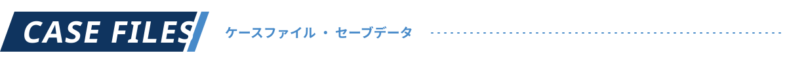

  <a href="https://hikikomorikai.com/">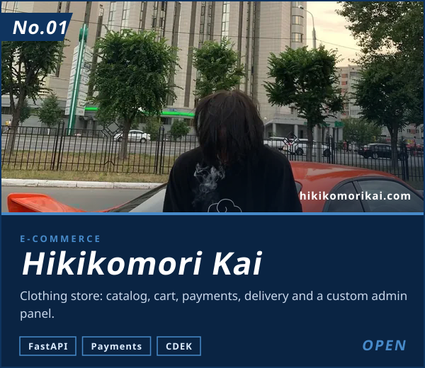</a> <a href="https://disdx44.cc/">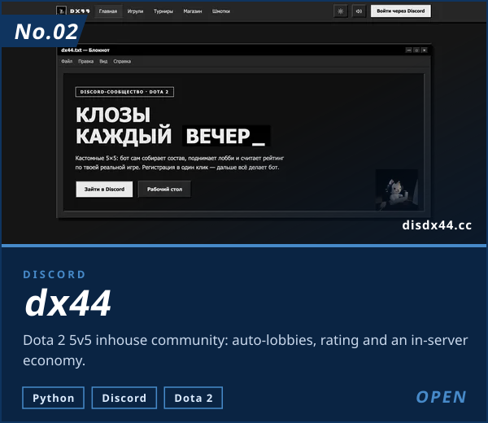</a>

  <a href="https://amurchai.ru/">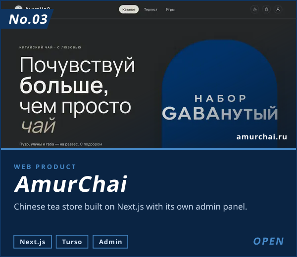</a> <a href="https://konata.shop/">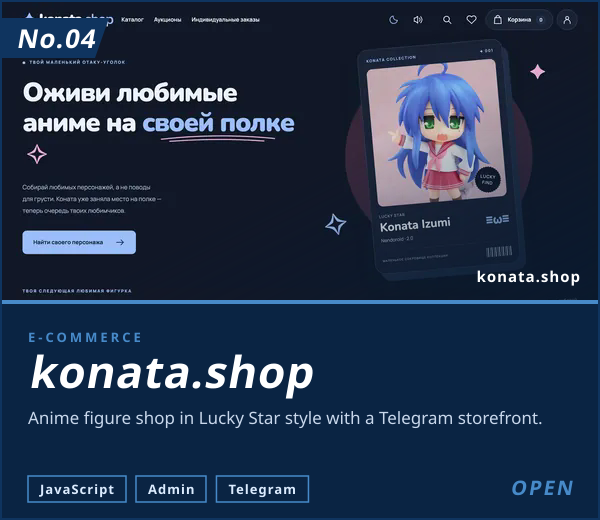</a>

  <a href="https://45squad.com/">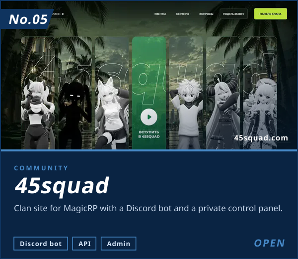</a> <a href="https://vexter.net/">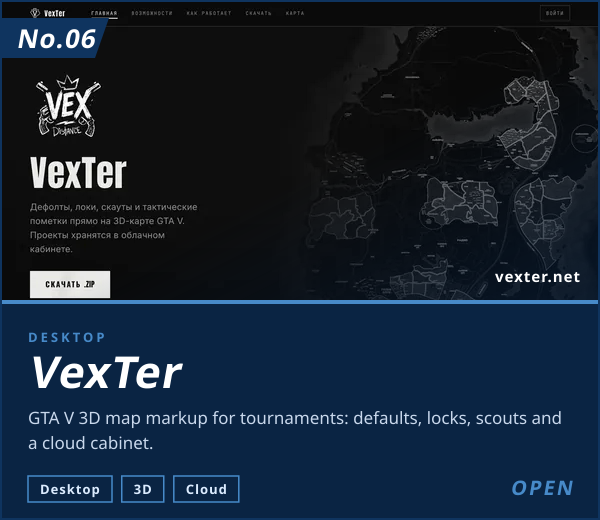</a>

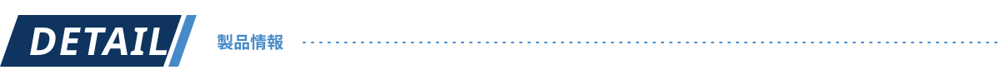


 

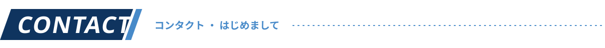

<a href="https://t.me/qqwm1ka"></a>

  
  &nbsp;
  

Most of my work lives in private repositories. The contribution graph includes anonymized private activity; source code and project details stay private. Fan-styled after <i>School Days</i>. Characters © Overflow.

<!-- nice boat. -->
