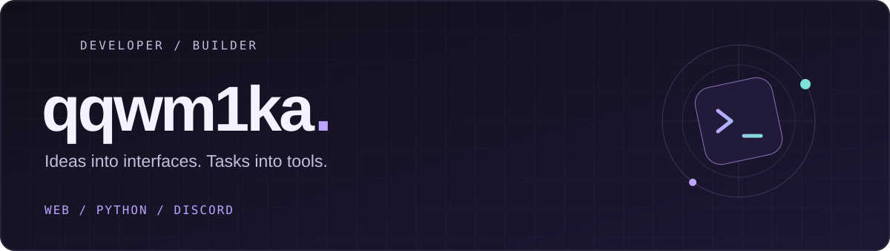

  

<strong>Small details. Useful software.</strong> 
Web projects, Python tools and Discord bots.

---

### What I build

- **Web** — websites, storefronts and dashboards with a focus on clear interfaces.
- **Tools** — Python utilities and automation for everyday work.
- **Communities** — Discord bots and integrations.

### My toolkit

`Python` · `JavaScript` · `TypeScript` · `HTML` · `CSS` · `Git`

### Behind the graph

Most of my work lives in private repositories. The contribution graph includes anonymized private activity; source code and project details stay private.

Built with care, one commit at a time.

